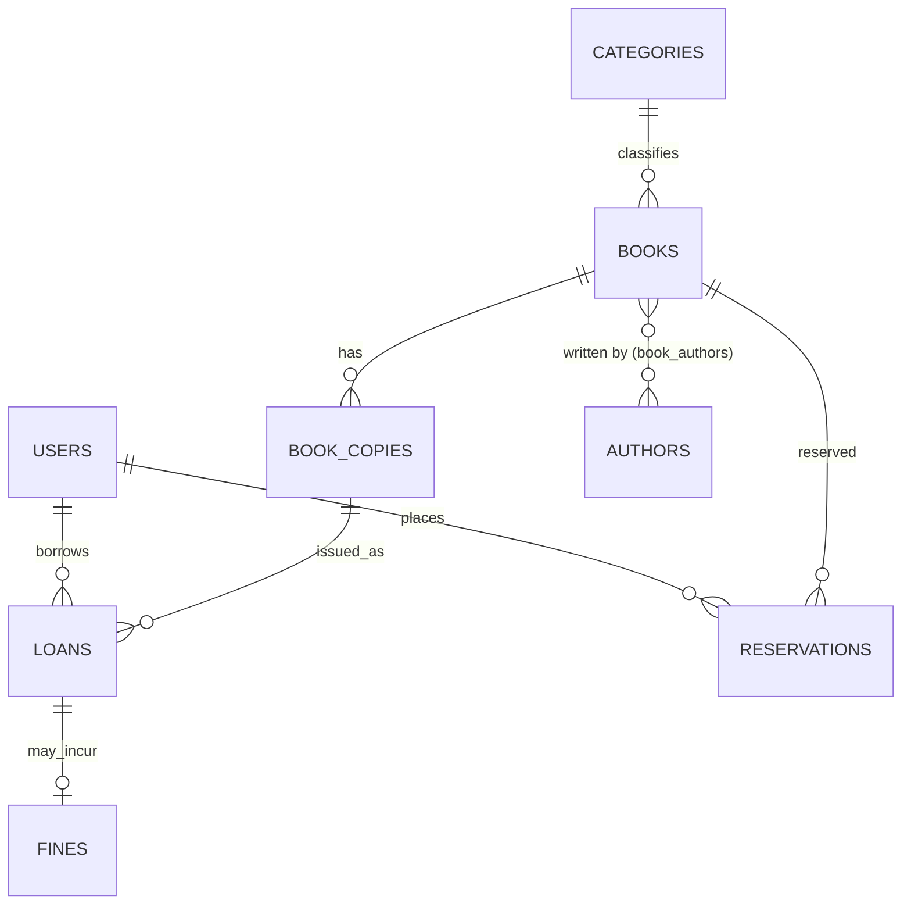

# Library Management Database (MySQL)

A relational database for managing **books, users, and transactions** (issue / return / tracking), with stored procedures, views, constraints, and fine handling.

## Features
- Normalized schema (3NF) with primary keys, foreign keys, `UNIQUE`, `CHECK`, and indexes
- Book catalog with multiple authors, categories, and multiple physical copies per title
- `issue_book` and `return_book` stored procedures (transactional, row-locked, with validation)
- Business rules: max 5 active loans, no issuing to users with unpaid fines, fine of 2.00 per overdue day
- Views for book availability and overdue loans
- Reservations table for waitlists

## ER Diagram


## Tables
| Table | Purpose |
|---|---|
| `users` | Members, librarians, admins |
| `authors`, `categories`, `books` | Catalog |
| `book_authors` | Many-to-many link between books and authors |
| `book_copies` | Physical copies with status (`available`, `issued`, `lost`, `maintenance`) |
| `loans` | Issue/return transactions |
| `fines` | Late-return fines |
| `reservations` | Waitlist for books |

## Setup
Requires MySQL 8.0.16+ (for `CHECK` constraints).
```bash
mysql -u root -p < schema.sql
mysql -u root -p < sample_data.sql
mysql -u root -p < queries.sql
```

## Usage
```sql
CALL issue_book(copy_id, user_id, librarian_id, days);  -- issue
CALL return_book(loan_id);                              -- return (auto-fine if late)
SELECT * FROM v_overdue_loans;                          -- track overdue
SELECT * FROM v_book_availability;                      -- availability
```
`queries.sql` contains 10 ready-to-run queries (search, user history, most borrowed, unpaid fines, etc.).

## Files
- `schema.sql` – tables, views, stored procedures
- `sample_data.sql` – demo data
- `queries.sql` – issue, return, and tracking queries
